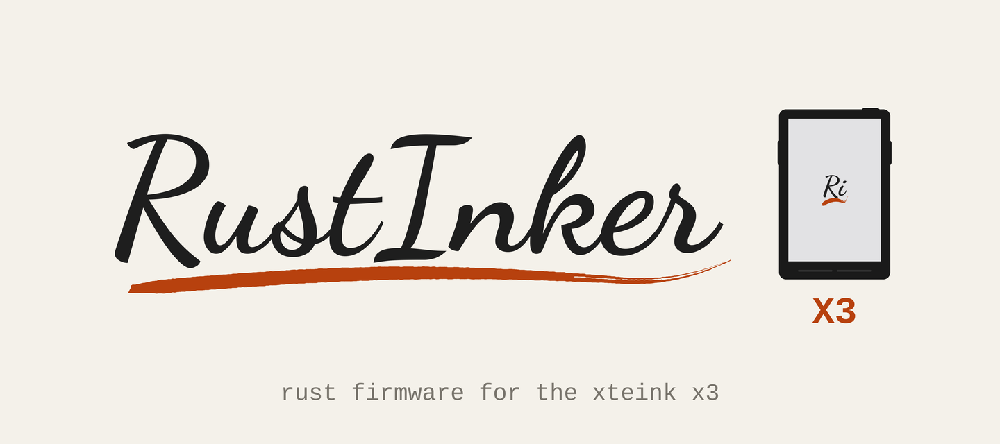
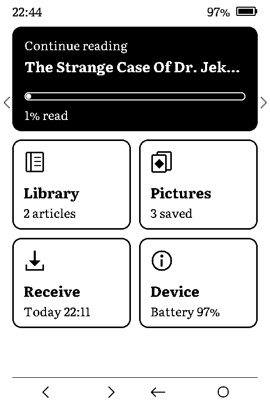
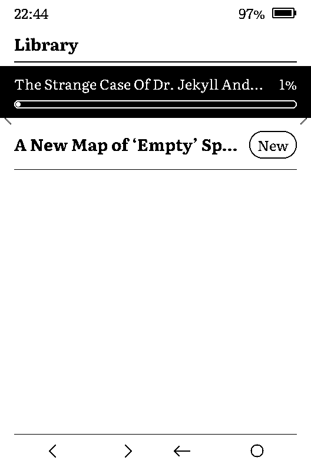
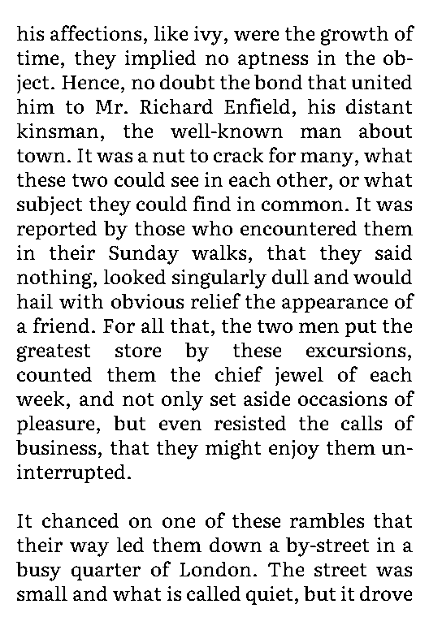
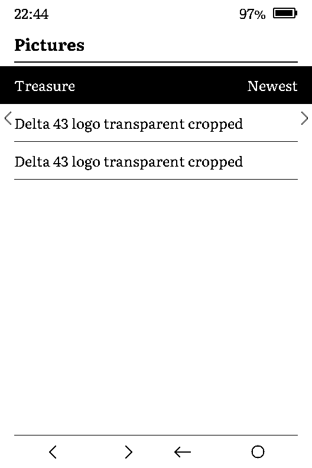

<p align="center">
  
</p>

<h1 align="center">RustInker-X3</h1>

<p align="center">
  <i>Open-source Rust firmware that turns the Xteink X3 into an offline article reader and a Magic: The Gathering token display, fed from your own server when you press Receive.</i>
</p>

<p align="center">
  <a href="LICENSE-MIT"></a>
  
  <a href="https://github.com/Delta-43/rustinker-x3/commits/main"></a>
  <a href="https://github.com/Delta-43/rustinker-x3/graphs/contributors"></a>
</p>

<p align="center">
  
  
  <a href="companion/Dockerfile"></a>
  <a href="https://github.com/Delta-43/rustinker-x3/actions/workflows/ci.yml"></a>
  <a href="https://github.com/Delta-43/rustinker-x3/releases/latest"></a>
</p>

<p align="center">
  
  
  
</p>

<p align="center">
  <a href="#how-it-works">How it works</a> •
  <a href="#why-this-design">Why this design</a> •
  <a href="#components">Components</a> •
  <a href="#project-status">Project status</a> •
  <a href="#quick-start">Quick start</a> •
  <a href="#tech-stack">Tech stack</a> •
  <a href="#project-structure">Project structure</a> •
  <a href="#documentation">Documentation</a> •
  <a href="#contributing">Contributing</a> •
  <a href="#credits">Credits</a> •
  <a href="#license">License</a>
</p>

> [!IMPORTANT]
> Installing writes one app slot and keeps your current firmware in the other, so you can
> always go back. [docs/INSTALL.md](docs/INSTALL.md) starts with a full flash backup and says
> how to tell whether your unit is locked against custom firmware.

---

## How it works

```text
phone or browser ──► companion (your server) ──► X3, when you press Receive
```

You send a web page, an email summary, a token or a picture to **x3-companion**, a
small Rust server you run at home. It fetches and converts the content and keeps it in
a durable inbox. When you choose **Receive** on the X3, the device joins Wi-Fi, pulls
what is waiting, checks every item's SHA-256, saves it to the microSD card and turns
Wi-Fi off again. Everything is then read offline.

<p align="center">
  
  
  
  
</p>

<p align="center">
  <sub>Captured from the device over USB (<a href="docs/DEVELOPMENT.md#screen-capture">how</a>).</sub>
</p>

- **Reader** — articles and summaries in Literata, hyphenated for English and Polish, with read state and a remembered place; whole books open page by page from the card.
- **Tokens and pictures** — Magic: The Gathering tokens looked up on Scryfall, and your own images, shown in four greys; any picture can be the sleep screen.
- **Receive** — about 4 s when nothing is waiting, at home over the LAN or away through a signed TLS route.
- **Power-cut safe** — every write goes to a temporary file, then a rename; 5 resets mid-download on the device and 3,162 simulated cuts on the host all recovered.
- **Wi-Fi from the phone** — a short-lived hotspot with one page adds up to four networks; no typing on the device.

## Why this design

- **The device pulls, the server pushes nothing** — the X3 runs no server; an HTTPS page cannot call a plain-HTTP device anyway, and pulling only on Receive keeps Wi-Fi off the rest of the time.
- **Heavy work off the device** — the ESP32-C3 has about 380 KB of RAM and no PSRAM. Page extraction, image dithering and layout run on the companion; the X3 gets ready-to-draw payloads.
- **Next to your current firmware, not instead of it** — only `app1` and the boot selector are written. **Device → Switch firmware** goes back without a computer.
- **Host-first** — `crates/core` is `no_std` logic shared by firmware, simulator and companion, so screens, codecs and the cache are tested on a PC (220 host tests) before they touch hardware.
- **Measured, not guessed** — RAM, stack, refresh times and battery draw are logged on the device; numbers in the docs come from those logs.

## Components

| Component | Path | Role |
| --- | --- | --- |
| Firmware | [`crates/fw`](crates/fw) | ESP32-C3 binary: drivers and glue (display, SD, buttons, Wi-Fi, TLS) |
| Core | [`crates/core`](crates/core) | `no_std` logic: payload codecs, text layout, screens, cache index |
| Protocol | [`crates/proto`](crates/proto) | Wire formats shared by device and server |
| Simulator | [`crates/sim`](crates/sim) | Draws every screen to PNG ([`samples/gui`](samples/gui)) |
| Companion | [`companion`](companion) | `x3-companion`: SQLite inbox, conversion, web page, device API |
| Tools | [`tools`](tools) | Host CLIs, serial helper, soak and power-cut drills |

## Project status

**v0.1.1, in daily use on one X3** (ESP32-C3 rev 4, 16 MB flash, UC8253 panel). Every
screen, Receive over LAN and internet, tokens, pictures and the power-cut recovery are
verified on that unit. Not yet done: a 7-day battery run, a 24 h soak, UC8279 panels and
any second unit. Hardware facts, each marked verified or not, are in
[docs/HARDWARE.md](docs/HARDWARE.md).

## Quick start

Back up first ([docs/INSTALL.md](docs/INSTALL.md#2-back-up-the-whole-flash)), then either download
`rustinker-x3-vX.Y.Z-app1.bin` from the [latest release](https://github.com/Delta-43/rustinker-x3/releases/latest)
or build it:

```bash
git clone https://github.com/Delta-43/rustinker-x3.git
cd rustinker-x3
cargo build -p fw --release --target riscv32imc-unknown-none-elf
esptool --chip esp32c3 elf2image --flash-mode dio --flash-size 16MB \
  -o fw-app1.bin target/riscv32imc-unknown-none-elf/release/fw
```

Make the boot selector from your own backup, then flash one command at a time and stop
on any error:

```bash
cargo run -p x3-tools -- otadata-select backup.bin 1 otadata-app1.bin
esptool --port PORT write-flash 0x780000 fw-app1.bin
esptool --port PORT write-flash 0xe000 otadata-app1.bin
```

The reader works without a server. To send things from a phone, run the companion
([docs/COMPANION_SETUP.md](docs/COMPANION_SETUP.md)):

```bash
docker build -f companion/Dockerfile -t x3-companion:local .
```

## Tech stack

<p align="center">
  
  
  
  
  
  
  
</p>

## Project structure

```text
crates/core      # no_std logic shared by device, simulator and companion
crates/proto     # request and response types for the device API
crates/fw        # ESP32-C3 firmware binary
crates/sim       # desktop simulator, screens to PNG
companion/       # x3-companion server and its web page
tools/           # host CLIs, x3cmd.py serial helper, soak and drill scripts, notices.py
infra/           # Docker Compose and Caddy examples, no secrets
config/          # *.example.cfg files for the SD card
assets/          # Literata font tables, the banner, screenshots from the device
samples/gui/     # simulator pictures of every screen
docs/            # install, user guide, companion, hardware, protocol, security
```

## Documentation

| Doc | What's in it |
| --- | --- |
| [INSTALL.md](docs/INSTALL.md) | Check the chip, back up, flash `app1`, go back, locked units |
| [USER_GUIDE.md](docs/USER_GUIDE.md) | Keys, Home, Library and reader, Pictures, Receive, Device menu, Wi-Fi setup |
| [COMPANION_SETUP.md](docs/COMPANION_SETUP.md) | Running x3-companion, the web page, Receive away from home, backups |
| [HARDWARE.md](docs/HARDWARE.md) | Pins, keys, display, SD, I²C devices, power, flash layout |
| [PROTOCOL.md](docs/PROTOCOL.md) | Device API, companion API, card files, payload formats |
| [SECURITY.md](docs/SECURITY.md) | Threat model, protections, known limits |
| [DEVELOPMENT.md](docs/DEVELOPMENT.md) | Layout, build and test, simulator, tools, serial console, screen capture |
| [DECISIONS.md](docs/DECISIONS.md) | The design decisions (ADRs) the code refers to |
| [THIRD_PARTY.md](THIRD_PARTY.md) | Licences of every dependency, font and borrowed constant |

## Contributing

Issues and pull requests are welcome, above all reports from other X3 units (panel
controller, flash chip, lock status). Run `cargo fmt --all -- --check`,
`cargo clippy --workspace --all-targets -- -D warnings` and
`cargo test --workspace --exclude fw` before a pull request. Hardware claims need
output from a real device. Never commit a flash dump, Wi-Fi details or a device token.

This project is unofficial and not associated with Xteink, Wizards of the Coast or
Scryfall. It ships no card art and no Scryfall data; card images are fetched when you
send one and shown in four greys on your own device, as a personal display under
[Scryfall's terms](https://scryfall.com/docs/api).

## Credits

Built by [Delta-43](https://github.com/Delta-43) together with
[Claude Code](https://claude.com/claude-code) (Anthropic), from the first hardware notes
to this release. Panel constants and the grey method build on MarigoldOS, CrossPoint
Reader and CrossPlant (MIT); see [THIRD_PARTY.md](THIRD_PARTY.md).

## License

Original code is [MIT](LICENSE-MIT) OR [Apache-2.0](LICENSE-APACHE), at your choice.
The display driver constants come from MIT-licensed projects and the Literata font is
under the SIL Open Font Licence ([THIRD_PARTY.md](THIRD_PARTY.md)). A released firmware
file ships with `NOTICES.txt`, generated by [`tools/notices.py`](tools/notices.py), which
carries the licence of every crate and of Espressif's prebuilt radio libraries
(Apache-2.0) built into it.

---

<p align="center">
  <a href="https://github.com/Delta-43/rustinker-x3/graphs/contributors">
    
  </a>
</p>

<p align="center">
  <sub>Licensed under <a href="LICENSE-MIT">MIT</a> or <a href="LICENSE-APACHE">Apache-2.0</a>.</sub>
</p>
