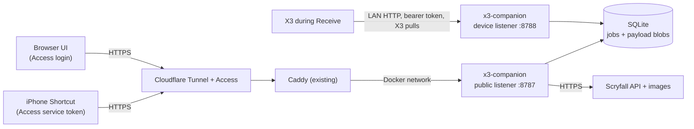

# Companion infrastructure

Updated 2026-10-22. Status: **design approved (ADR 008, ADR 009); nothing deployed.**
Wire details are in PROTOCOL.md. Deployment changes need the owner to review the
concrete diff first (Phase 1C).

## 1. Inventory (read-only check, 2026-10-22)

| Item | Finding | Still to do |
| --- | --- | --- |
| Home server | home-server: Ubuntu 26.04, x86_64, 4 cores, 22 GB RAM, ~47 GB free, Docker, on the X3's home LAN | LAN address reserved on the router: **192.168.1.20** (owner, 2026-10-22). X3 config: `url=http://192.168.1.20:8788` |
| Caddy | `caddy` container on home-server; port 80 published on all interfaces | Add one site block for the companion; account for LAN-side access that bypasses Cloudflare |
| Cloudflare Tunnel | `cf-caddy-tunnel` container on home-server | Add one public hostname → Caddy |
| Cloudflare Access | Exists on the account; policies not inspected | One Access application for the companion hostname: owner login + one service token for the Shortcut |
| n8n | `n8n` container on home-server | Not used in v1 (later automations call the companion API) |
| public-vps | Public VPS, no path to the home LAN | Not used |
| X3 | Runs CrossPoint, on home Wi-Fi (owner) | Our firmware later; Phase 2 gate |

Do not record secrets, public IPs or tokens in this repository.

## 2. Topology



- One process, two listeners. The public listener has no host port; Caddy reaches
  it over the shared Docker network. The device listener is published only on
  the server's reserved LAN address, port 8788.
- The X3 starts every connection. The companion never needs to find the device.
- No Tailscale, n8n or device web server in v1.

## 3. Responsibilities

| Component | Owns | Does not |
| --- | --- | --- |
| Cloudflare Access | Who may reach the companion hostname | Act as the only check: the companion verifies the Access JWT itself |
| Caddy | Routing the hostname to the public listener | Expose `/device/*`, admin or other paths externally |
| Companion | Validation, Scryfall fetch, conversion, previews, durable jobs, idempotency, leases, retention, backups | Push to the device; trust unverified identity headers |
| X3 | Pull, verify, commit to SD, ack, offline reading and display | Run a server, VPN or tunnel |

## 4. Flows

**Article or summary from the iPhone.** Share Sheet Shortcut extracts title,
URL and text on the phone, makes a `submission_id` (UUID) once, and POSTs to
`/api/v1/articles` with the Access service-token headers. It retries with the same
ID. The companion commits job and content in one SQLite transaction before it
answers 202. Then it encodes the `ar1` payload in the background (`ready`).

**Token from the browser.** The UI searches through `/api/v1/scryfall/search`,
picks a card, chooses fit/orientation/show, and loads
`/api/v1/tokens/preview.png` (exact device pixels from x3-core; creates no job).
"Queue" then posts `/api/v1/tokens` with the preview's `expected_sha256`.

**Receive.** The owner presses Receive on the X3. It sends `hello`, lists jobs,
downloads, verifies, commits, acks, repeats until the list is empty, then turns
Wi-Fi off. A lost ack makes the job reappear after its lease; the device
recognises the hash and acks without downloading again.

## 5. Data and backups

- Data directory (Docker volume or bind mount on home-server):
  `inbox.sqlite` (WAL mode) and `backups/`.
- Payloads and originals are blobs in SQLite. One transaction = one consistent
  state; no file reconciliation.
- Nightly `VACUUM INTO backups/inbox-<date>.sqlite`, keep 7. The owner's
  existing host backup collects that directory. Restore = stop the container,
  replace `inbox.sqlite`, start. Test restore into a scratch instance in Phase 1B.
- Defaults (configurable): quota 512 MiB (submissions fail with 507 when full);
  finished jobs pruned after 30 days, keeping each item's newest delivered job
  without its payload (ADR 014); pending jobs never pruned; Scryfall cache
  pruned by age.

## 6. Security

| Hop | Control |
| --- | --- |
| Browser → companion | Access login; companion verifies `Cf-Access-Jwt-Assertion` (JWKS + audience) |
| Shortcut → companion | Access service token → Access issues the same JWT; companion verifies it |
| X3 → companion | Per-device 32-byte bearer token over the trusted LAN; stored hashed |
| Companion → Scryfall | Outbound HTTPS to two allowlisted hosts only |

- Caddy's port 80 is reachable from the LAN, so a LAN client could reach the
  public listener through Caddy without passing Access. JWT verification at the
  companion closes that gap. Never accept `Cf-Access-Authenticated-User-Email`
  or similar headers alone.
- The tailnet includes other people's devices. Tailnet membership is not owner
  identity.
- Content passes through Cloudflare's edge in clear text at the edge. Acceptable
  for articles and tokens; don't send private mail through it.
- Logs never contain submitted text, tokens or JWTs.

## 7. Deployment (Phase 1C, owner reviews before applying)

Files Codex prepares under `infra/` (examples, no secrets):

- `infra/companion/compose.example.yml`: the companion service, data volume,
  attachment to Caddy's existing Docker network, device port bound to
  `${LAN_IP}:8788`, environment for the Access team domain and audience.
- `infra/caddy/x3-companion.example.caddy`: one site block:

```caddyfile
http://x3.example.com {
    @device path /device/*
    respond @device 404
    reverse_proxy x3-companion:8787
}
```

- `infra/README.md`: steps: confirm the LAN IP (192.168.1.20); create the Access application and
  service token; add the Tunnel public hostname; add the Caddy block; start the
  container; run `x3-companion device add x3`; write `/x3/server.cfg` on SD.

Rollback: remove the Caddy block and the Tunnel hostname, stop the container.
The data volume stays. No other service on home-server is changed.

## 8. Acceptance tests

| Test | Expected | Stage |
| --- | --- | --- |
| Submit while no device is connected | 202 only after commit; job `ready` later | 1B, agent |
| Kill companion after 202, restart | Job and content intact, no duplicate | 1B, agent |
| Same `submission_id` twice; changed body | 200 same job; 409 | 1B, agent |
| Simulated device pull, lost ack | One item on the simulated SD; ack replay accepted | 1B, agent |
| Cancel wins the race (before any payload is served) | 200; payload 404; job unlisted; nothing committed | 1B, agent |
| Delivery wins the race (payload already served) | Cancel 409, also after lease expiry; later ack accepted | 1B, agent |
| Device acks a cancelled job it already held (skip path) | Ack 404; device treats as done; no new item | 1B, agent |
| Real axum 204 ack over TCP | Device client accepts it (no Content-Length) | 1B, agent |
| Token preview | PNG + hash; no job created; mismatch on submit → 409 | 1B, agent |
| Oversized, malformed, wrong auth, disk full | Clean error, no job, no partial state | 1B, agent |
| Backup and restore to scratch instance | Same jobs and payload hashes | 1B, agent |
| Request without valid Access JWT, incl. via LAN port 80 | 401 | 1C, agent + owner |
| `/device/*` via public hostname | 404 | 1C, agent + owner |
| Shortcut and browser over HTTPS | JSON response, not a login page | 1C, owner |
| Real X3 Receive | Items delivered, Wi-Fi off after, offline reading works | Phase 4–6, owner |
