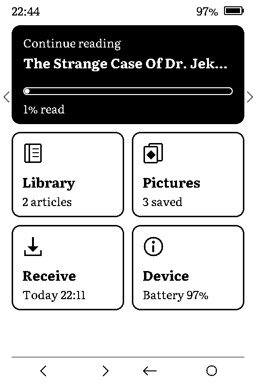
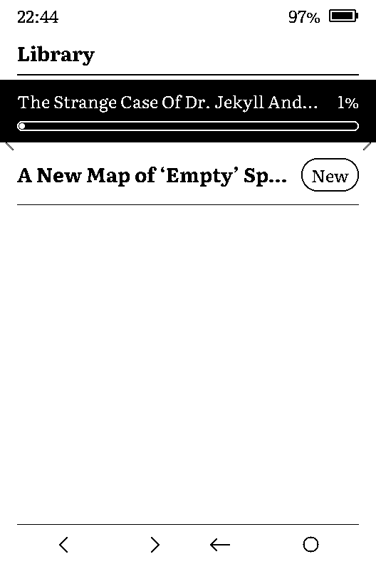
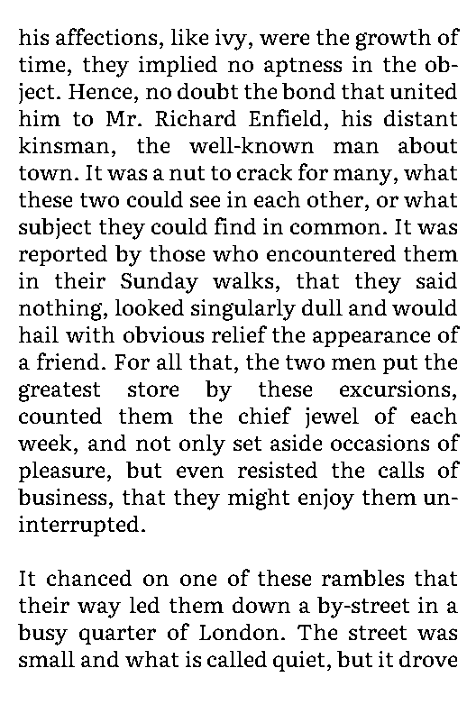
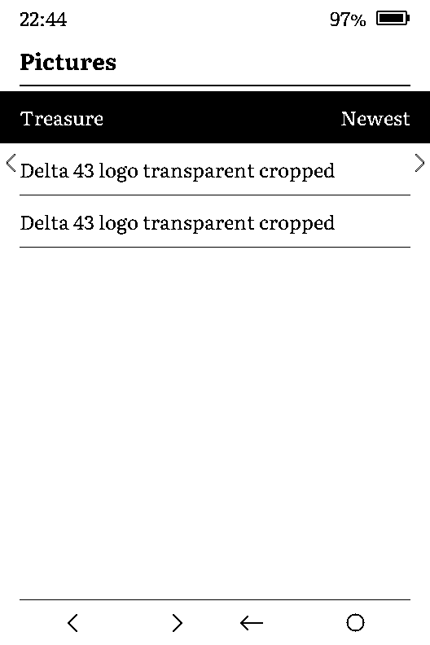
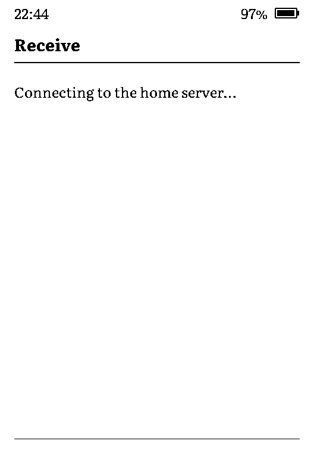

# User guide

What you see and press once RustInker-X3 is installed ([Install](INSTALL.md)).

  
  
  

## Buttons

Hold the X3 upright, buttons at the bottom.

| Where | Button | Does |
| --- | --- | --- |
| Bottom, left bar, left end | **Left** `<` | previous page or item |
| Bottom, left bar, right end | **Right** `>` | next page or item |
| Bottom, right bar, left end | **Back** `←` | leave this screen |
| Bottom, right bar, right end | **Confirm** `○` | open or choose |
| Left side key | **Up** | same as Left |
| Right side key | **Down** | same as Right |
| Top edge, right | **Power** | sleep and wake |
| Top edge, left | **Reset** | restarts the device (a hardware reset, not a key) |

The bar at the foot of each screen shows only the keys that do something there.
Reset never deletes anything on the card.

## Home

A **Continue reading** card with a progress bar, and four tiles: **Library**,
**Pictures**, **Receive** and **Device**. Left and Right move the highlight; Confirm opens
it. Back redraws the whole screen, which clears ghosting. Power puts the X3 to sleep.

Screens change with a quick refresh; every sixth change is a full refresh that flashes
once to keep the screen clean.

## Library and reader

Your articles and summaries, newest first. A bold title marked **New** is unread. A bar
and a percentage show how far you got. **Read** means you reached the end.

In the reader, Right turns to the next page and Left to the previous one. Confirm redraws
the page with a full refresh. Back leaves, and the device remembers your place. Leave from
the last page and the article counts as read; opening it again starts from the top.

A page turn takes about 0.4 s. Long articles and whole books open: the reader reads the
text from the card a part at a time, so now and then a turn takes a moment longer.

## Pictures

  

The last 20 pictures you sent, shown in four greys: Magic: The Gathering tokens and your
own images. Up and Down move through the list; Confirm shows one. On a picture, Left shows
an older one and Right a newer one, **Confirm makes it the sleep screen**, and Back leaves.

A picture sent with **Show** appears on its own when the Receive that brought it ends.

## Receive

  

Choose **Receive**. The X3 switches Wi-Fi on, asks your companion what is waiting,
downloads it to the card and switches Wi-Fi off. A result page lists what arrived and what
was removed; any key returns to Home. Nothing half-saved ever appears in the library.

A Receive takes about 4 s when nothing is waiting, plus about 5 s for each picture and
up to about 10 s for a long article.

| Kind | Kept on the card | When full |
| --- | --- | --- |
| Pictures | the last 20 | the oldest goes; the one on screen stays |
| Articles | 32 | a finished article goes first, otherwise the oldest |

Removing an article or picture on the companion's page removes it from the X3 at the next
Receive.

**Away from home.** If `SERVER.CFG` has an `https://` address, Receive works on any saved
network, such as a phone hotspot ([Companion setup](COMPANION_SETUP.md#receive-away-from-home)).
At home it tries the LAN address first. If Receive says "The reply was not signed by your
companion", do not trust that connection: the route is misconfigured or something is
tampering with it.

## Device

| Entry | Does |
| --- | --- |
| **Wi-Fi** | choose the network Receive tries first, or add one |
| **Storage** | what is on the card; **Delete everything** removes all articles and pictures |
| **Clean screen** | flashes black and white for about 20 s to clear ghosting |
| **About this device** | firmware version, battery and clock |
| **Switch firmware** | restarts into the firmware in the other slot. Coming back needs a computer ([Install](INSTALL.md#go-back-to-the-previous-firmware)) |

## Wi-Fi setup

The X3 has no keyboard, so you add a network from your phone.

1. Device → Wi-Fi → **Add a network**. The X3 starts a hotspot and shows a QR code, the
   hotspot name (`X3-setup-…`) and a one-time password.
2. Scan the code with the phone camera and join. The phone may warn that there is no
   internet; that is expected.
3. In a browser open **192.168.4.1**. Pick your network or type its name, enter the
   password and tap Save.
4. The X3 closes the hotspot and tries the new network. The result is on its screen.

The hotspot stops after 5 minutes or when you press Back. The X3 keeps up to four networks;
a fifth replaces the oldest. When several are saved, Receive joins the strongest one it can
see, or the one you chose in Device → Wi-Fi. Networks with a login page (hotels, cafés) and
WPA-Enterprise do not work.

## Power and sleep

- The screen's power goes off after 3 s without a key press and comes back on the next
  press. (Leaving it on under a still image for hours causes ghosting.)
- **Power** on Home sleeps now. On battery the X3 also sleeps after 10 minutes without a
  key press. The screen then shows "Sleeping" with the article you were reading, or the
  picture you chose. **Power** wakes it.
- On USB the X3 stands by instead of deep-sleeping, because the chip cannot deep-sleep with
  a USB host attached. It looks the same, and Power wakes it.
- Wi-Fi is on only during a Receive. Reading is always offline.
- The clock shows Central European time (CET, CEST in summer).

## Files on the card

| File | What | Private |
| --- | --- | --- |
| `X3/WIFI.CFG` | up to four saved networks, with passwords | yes |
| `X3/SERVER.CFG` | the companion's address and the device token | yes |
| `X3/DATA/` | articles and pictures (`.DAT` and `.MET` files) | |
| `X3/LOG.TXT` | one line per Receive: time, counts, timings, battery | |
| `X3/SHOWN.CFG` | a pending "shown" note for the companion | |
| `X3/WIFI.PIN` | the network Receive tries first (name only) | |
| `X3/SLEEP.CFG` | the picture shown while asleep | |

Writes to `DATA` survive a power cut: a half-written item is ignored and cleaned up at the
next Receive.

## When something goes wrong

| You see | Likely cause | Try |
| --- | --- | --- |
| "Cannot reach the companion" | server off, wrong address, no route | check `SERVER.CFG`; open the companion's page from your phone |
| "The companion refused the device token" | wrong or removed token | make a new one ([Companion setup](COMPANION_SETUP.md#3-register-the-x3)) and update `SERVER.CFG` |
| "Receive timed out" | weak Wi-Fi or a slow server | move closer; Receive again |
| "Cannot write to the card" | card full, locked or damaged | check the card on a computer |
| "A download was damaged" | the network dropped bytes | Receive again |
| `Wi-Fi: …` with a code | the router refused the join; most often a wrong password | run Wi-Fi setup again |
| Wi-Fi fails right after a restart | the router still holds the old connection | wait a minute |
| The screen stops responding | | press Reset on the top edge |
